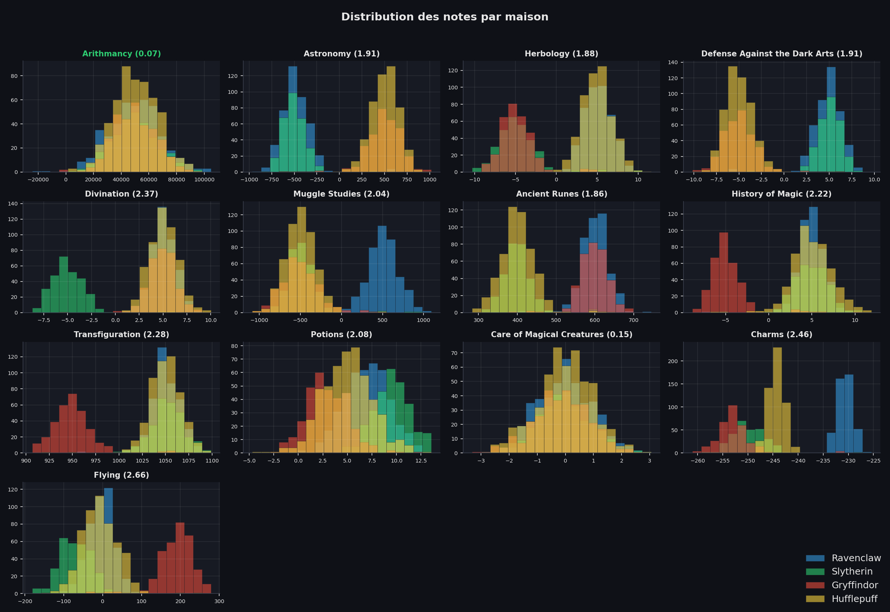
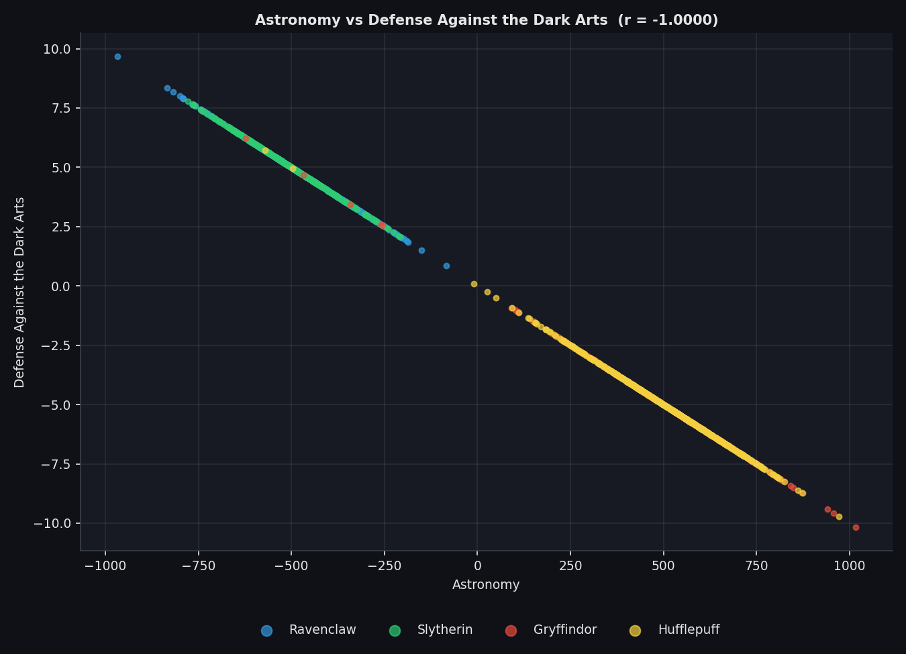
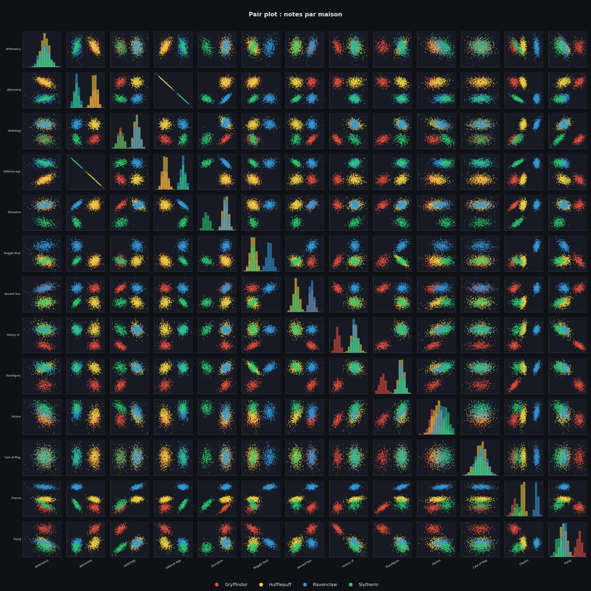
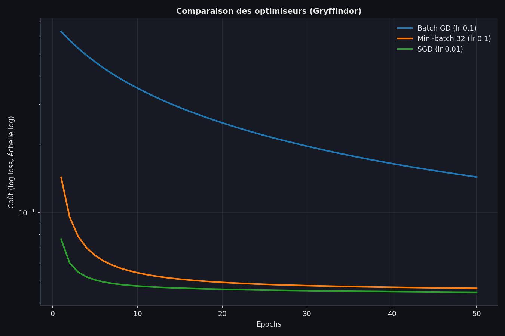

# DSLR: Data Science × Logistic Regression
 
We replace the Hogwarts' Sorting Hat with a classifier that predicts a student's house (Gryffindor, Hufflepuff, Ravenclaw, Slytherin) from their grades in 13 courses.
 
- `dataset_train.csv`: 1600 students with their house.
- `dataset_test.csv`: 400 students without it.
- Goal: accuracy ≥ 98 %.
## Setup
 
```bash
python3 -m venv venv && source venv/bin/activate
pip install -r requirements.txt
```
 
## Files
 
| File | Role |
|---|---|
| `csv_reader.py` | CSV loading, float conversion, numeric columns, grouping by house |
| `maths_utils.py` | `ft_*` statistics (count, mean, std, min, max, sort, percentile, correlation) |
| `plot_style.py` | Dark theme and house colors |
| `describe.py` | Statistics table |
| `histogram.py` | Which course is homogeneous across houses? |
| `scatter_plot.py` | Which two features are similar? |
| `pair_plot.py` | Which features to keep? |
| `logreg_utils.py` | Preprocessing, sigmoid, cost, gradient, optimizers |
| `logreg_train.py` / `logreg_predict.py` | Training (`weights.json`) and prediction (`houses.csv`) |
| `validate_split.py` / `validate.py` | Accuracy measurement |
| `compare_optim.py` | Bonus: optimizer comparison |
 
Missing grades are kept as `None` so that student *i* stays at index *i* in every column; they are only dropped when computing a statistic.
 
## describe.py
 
```bash
python3 describe.py datasets/dataset_train.csv [--all]
```
 
For $n$ valid values $x_i$:
 
- Mean: $\mu = \frac{1}{n}\sum x_i$
- Std: $\sigma = \sqrt{\frac{\sum (x_i-\mu)^2}{n-1}}$ (the $n-1$ corrects the bias of a sample, as pandas does)
- Percentile $p$ (linear interpolation on sorted values): $pos = p(n-1)$, $P = x_{\lfloor pos \rfloor} + (x_{\lfloor pos \rfloor+1} - x_{\lfloor pos \rfloor})\,(pos - \lfloor pos \rfloor)$
Bonus `--all`: variance, range, IQR, skewness, kurtosis.
 
## histogram.py
 
Four overlaid histograms (one per house, shared bins) per course. Homogeneity score:
 
$$score = \frac{\max_h \mu_h - \min_h \mu_h}{\sigma_{global}}$$
 
**Result:** Arithmancy (0.068) and Care of Magical Creatures (0.147) are homogeneous; all others score above 1.8.
 

 
## scatter_plot.py
 
Pearson correlation over the 78 course pairs, ranked by $|r|$:
 
$$r = \frac{\sum (x_i-\bar x)(y_i-\bar y)}{\sqrt{\sum (x_i-\bar x)^2 \sum (y_i-\bar y)^2}}$$
 
Only students with both grades are used. **Result:** Astronomy / Defense Against the Dark Arts, $r = -1.0000$.
 

 
## pair_plot.py
 
13×13 grid: histograms on the diagonal, scatter plots elsewhere, colored by house.
 
**Features kept (10):** Herbology, Defense Against the Dark Arts, Ancient Runes, Charms, Divination, Muggle Studies, History of Magic, Transfiguration, Potions, Flying.
**Dropped:** Arithmancy and Care of Magical Creatures (homogeneous), Astronomy (redundant with Defense, $r=-1$).
 

 
## Logistic regression
 
**Preprocessing:** missing value → column mean; standardization $x' = (x-\mu)/\sigma$ with $\mu,\sigma$ computed on the train set only, saved in `weights.json` and reused at prediction; a bias column of 1s is added.
 
**Model:**
 
- Sigmoid: $g(z) = \frac{1}{1+e^{-z}}$, hypothesis $h_\theta(x) = g(\theta^T x)$
- Cost: $J(\theta) = -\frac{1}{m}\sum \big[y\log h + (1-y)\log(1-h)\big]$
- Gradient: $\frac{\partial J}{\partial\theta_j} = \frac{1}{m}\sum (h_\theta(x^i)-y^i)\,x^i_j$
- Update: $\theta \leftarrow \theta - \alpha\,\nabla J$
**One-vs-all:** one binary classifier per house ($y=1$ for that house, else $0$); the predicted house is the `argmax` of the four probabilities.
 
```bash
python3 logreg_train.py datasets/dataset_train.csv [batch|sgd|minibatch]
python3 logreg_predict.py datasets/dataset_test.csv weights.json   # writes houses.csv
python3 validate_split.py datasets/dataset_train.csv [batch|sgd|minibatch]
```
 
**Results:** cost goes from $\ln 2 = 0.693$ to about 0.05. Validation accuracy on an 80/20 split: **98.12 %** (6 errors out of 320), identical for the three optimizers.
 
## Bonus
 
Optimizers differ only by batch size (one epoch = one pass over the data):
 
| Method | Batch size | Updates / epoch |
|---|---|---|
| Batch GD | 1600 | 1 |
| Mini-batch | 32 | 50 |
| SGD | 1 | 1600 |
 
Data is shuffled every epoch. All three reach the same minimum (the cost is convex); SGD and mini-batch get there in fewer epochs. `compare_optim.py` plots the cost curves.
 

